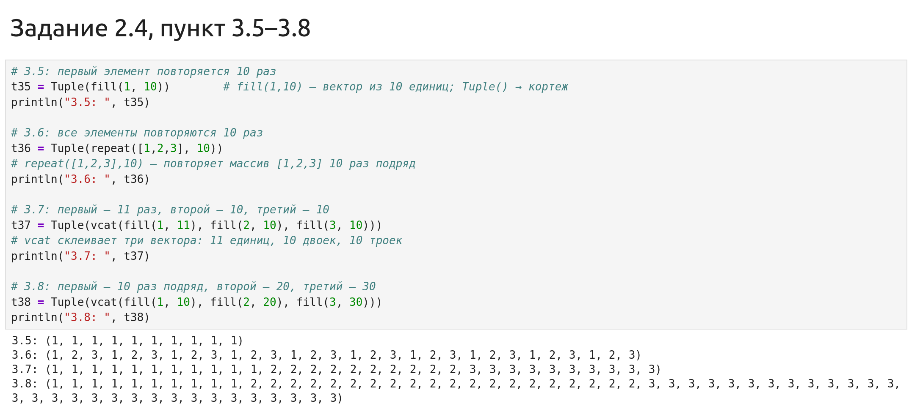
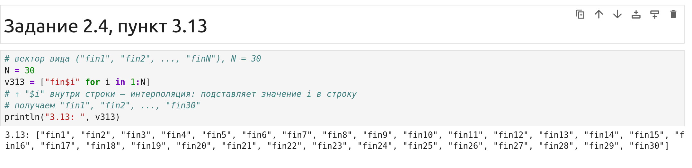
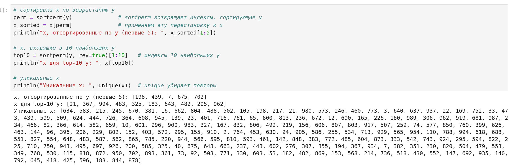
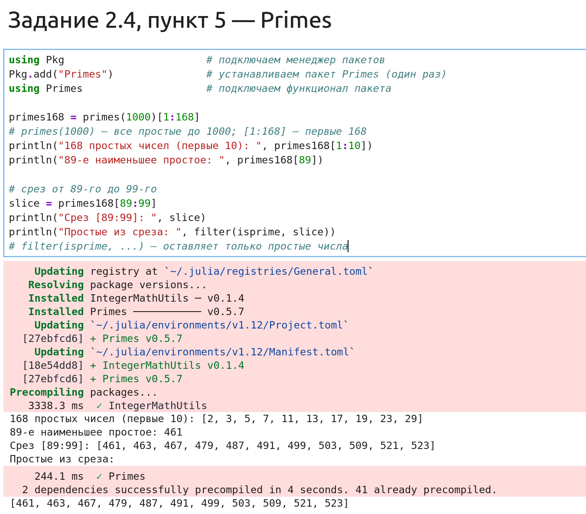

---
## Author
author:
  name: Дагделен Зейнап Реджеповна
  email: 1132236052@rudn.ru
  affiliation:
    - name: Российский университет дружбы народов
      country: Российская Федерация
      city: Москва
      address: ул. Орджоникидзе
## Title
title: Отчёт по лабораторной работе №2
subtitle: Структуры данных в Julia
license: CC BY
date: today
date-format: "YYYY-MM-DD"
---

# Информация

## Докладчик

:::::::::::::: {.columns align=center}
::: {.column width="70%"}

  * Дагделен Зейнап Реджеповна
  * студентка
  * Российский университет дружбы народов им. П. Лумумбы
  * [1132236052@rudn.ru](mailto:1132236052@rudn.ru)

:::
::: {.column width="30%"}

:::
::::::::::::::

::: notes
- Поприветствовать аудиторию.
- Представиться кратко.
:::

# Вводная часть

## Актуальность

- Изучение структур данных — фундаментальная часть подготовки IT-специалистов
- Владение различными структурами позволяет эффективно решать прикладные задачи
- Julia предоставляет мощный инструментарий для работы с данными

::: notes
- Почему важно изучать структуры данных.
- Время: не более 1 минуты на этот слайд.
:::

## Цель работы

- Изучить основные структуры данных в языке Julia
- Освоить методы их создания, преобразования и анализа
- Получить практические навыки работы с генераторами и внешними пакетами

::: notes
- Цель сформулирована четко и соответствует методическим указаниям.
:::

## Задачи

- Изучить синтаксис и операции над множествами
- Освоить создание и обработку кортежей
- Научиться применять генераторы списков
- Изучить методы фильтрации, сортировки и статистического анализа
- Подключить и использовать внешние пакеты (на примере `Primes`)

::: notes
- Обратить внимание, задач ровно пять.
- Это удобно для восприятия.
:::

## Материалы и методы

- Среда разработки: JupyterLab
- Язык программирования: Julia (версия 1.12)
- Внешний пакет: `Primes` для работы с простыми числами
- Все вычисления проводились на локальной машине

::: notes
- Предлагается использовать наиболее популярные инструменты.
- JupyterLab позволяет наглядно демонстрировать результаты.
:::

# Выполнение работы

## Обзор выполненной работы

- Выполнены все задания из раздела 2.4 методических указаний
- Работа включает 6 основных заданий:
    - Множества
    - Примеры с разными типами
    - Создание массивов разными способами (14 пунктов)
    - Квадраты чисел
    - Простые числа
    - Вычисление выражений

::: notes
- Кратко описать структуру работы.
- Показать, что все задания выполнены.
:::

## Задание 1. Множества

- Даны множества: A = {0, 3, 4, 9}, B = {1, 3, 4, 7}, C = {0, 1, 2, 4, 7, 8, 9}
- Необходимо найти: $P = A \cap B \cup A \cap C \cup B \cap C$
- Использованы операции: `union` (объединение), `intersect` (пересечение)

{#fig-002 width=60%}

::: notes
- Результат: P = {0, 1, 3, 4, 7, 9}
- Показать, что операции работают корректно.
:::

## Задание 2. Примеры с разными типами

- Созданы множества целых чисел, строк и смешанных типов. Выполнены операции объединения и пересечения, операция разности и проверка принадлежности

{#fig-003 width=60%}

::: notes
- Множества могут хранить элементы разных типов.
- Проверка принадлежности работает для всех типов.
:::

## Задание 3.1–3.4. Кортежи

- Созданы кортежи с последовательностями чисел от 1 до N (N=25): 1) возрастающие, 2) убывающие, 3) симметричные, 4) произвольный кортеж

{#fig-005 width=60%}

::: notes
- Кортежи — неизменяемые структуры данных.
- Показать разнообразие способов создания.
:::

## Задание 3.5–3.8. Повторения

- Созданы кортежи с повторяющимися элементами
- Использованы функции: `fill`, `repeat`, `vcat`

{#fig-006 width=60%}

::: notes
- `fill` — заполняет одинаковыми значениями.
- `repeat` — повторяет массив несколько раз.
- `vcat` — склеивает векторы.
:::

## Задание 3.9–3.10. Степени и функция

создан массив степеней двойки, подсчитано количество вхождений числа 6 (0 раз), вычислена функция $y = e^x \cdot \cos(x)$ и найдено её среднее значение

{#fig-007 width=60%}

::: notes
- Среднее значение y ≈ 53.11.
- Векторизованные операции позволяют компактно записывать формулы.
:::

## Задание 3.11–3.12. Векторы и генераторы

- Создан вектор кортежей $(x^i, y^j)$
- Создан вектор с элементами $2^i / i$

{#fig-008 width=60%}

::: notes
- Генераторы списков позволяют создавать массивы по формулам.
- Двойной генератор создает вектор кортежей.
:::

## Задание 3.13. Вектор строк

- Создан вектор строк вида `"fin1"`, `"fin2"`, ..., `"fin30"`
- Использована интерполяция строк

{#fig-009 width=60%}

::: notes
- Интерполяция строк — удобный способ формирования строк.
:::

## Задание 3.14. Большая задача (начало)

- Сгенерированы случайные векторы $x$ и $y$ длины 250
- Вычислены векторы $v1, v2, v3$ и сумма

{#fig-010 width=60%}

::: notes
- $v1$ — разности соседних элементов $y$.
- $v2$ — комбинация трех подряд идущих элементов $x$.
- $v3$ — отношение синуса $y$ к косинусу следующего $x$.
:::

## Задание 3.14. Поиск и статистика

Выполнен поиск индексов элементов $y > 600$ и соответствующих им значений $x$, вычислен вектор $v4$, подсчитано количество $y$, близких к максимуму, подсчитано количество четных, нечетных и кратных 7 чисел в $x$

{#fig-012 width=60%}

::: notes
- Найдено 51 значение $y$, близкое к максимуму.
- Четных x: 132, нечетных: 118, кратных 7: 31.
:::

## Задание 3.14. Сортировка

- Выполнена сортировка $x$ по $y$
- Выборка топ-10 $y$
- Вывод уникальных значений $x$

{#fig-013 width=60%}

::: notes
- `sortperm` возвращает индексы, сортирующие $y$.
- `unique` убирает повторяющиеся значения.
:::

## Задание 4. Квадраты чисел

- Создан массив квадратов чисел от 1 до 100
- Выведены первые и последние 10 элементов

{#fig-014 width=60%}

::: notes
- Генератор списка позволяет компактно создать массив квадратов.
:::

## Задание 5. Простые числа, пакет `Primes`

{#fig-015 width=50%}

::: notes
- Пакет `Primes` предоставляет эффективные алгоритмы.
- 89-е простое число — 461.
:::

## Задание 6. Вычисление выражений

- Вычислены суммы:
    - $\sum_{i=10}^{100} (i^3 + 4i^2)$
    - $\sum_{i=1}^{25} ((2^i)/i + (3^i)/(i^2))$
- Вычислена сумма ряда $1 + 2/3 + (2\cdot4)/(3\cdot5) + ...$

{#fig-016 width=60%}

::: notes
- Результат первой суммы: 26852735.
- Результат второй суммы: 2.129e9.
- Сумма ряда: 9.256.
:::

# Результаты

## Итоги работы

- Изучены синтаксис и операции для кортежей, словарей, множеств и массивов в Julia
- Успешно выполнены все 14 пунктов заданий для самостоятельной работы
- Получены числовые результаты для задач 3.9, 3.10, 3.14, 6.1, 6.2, 6.3
- Сформированы векторы и массивы в соответствии с заданиями

::: notes
- Все задания выполнены в полном объеме.
:::

## Обсуждение результатов

- Результаты полностью соответствуют ожидаемым
- Использование генераторов списков и встроенных функций Julia позволило компактно решить задачи
- Трудностей при выполнении не возникло

::: notes
- Синтаксис языка интуитивно понятен.
- Документация доступна.
:::

# Заключение

## Главный вывод

В ходе лабораторной работы были изучены основные структуры данных в Julia. Все задания выполнены в полном объеме. Цель работы достигнута.

::: notes
- Финальный аккорд.
- Поблагодарить за внимание и перейти к вопросам.
:::
