---
## Author
author:
  name: Дагделен Зейнап Реджеповна
  email: 1132236052@rudn.ru
  affiliation:
    - name: Российский университет дружбы народов
      country: Российская Федерация
      city: Москва
      address: ул. Орджоникидзе

## Title
title: "Отчёт по лабораторной работе №2"
subtitle: "Структуры данных"
license: "CC BY"
abstract: |
  В данном отчёте представлены результаты выполнения лабораторной работы по теме «Структуры данных» на языке Julia.

  Описаны использованные структуры данных (кортежи, множества, массивы), методы их создания и операции над ними. Приведены примеры выполнения заданий для самостоятельной работы.

  Сделаны выводы о достижении поставленной цели.
keywords: [лабораторная работа, Julia, структуры данных, множества, массивы, кортежи]
---

# Введение

## Актуальность

Изучение структур данных является фундаментальной частью подготовки специалистов в области информационных технологий. Владение различными структурами данных и операциями над ними позволяет эффективно решать широкий круг прикладных задач, от обработки данных до реализации алгоритмов.

## Цель работы

Основная цель работы — изучить несколько структур данных, реализованных в Julia, научиться применять их и операции над ними для решения задач [@bezanson_julia_2017].

## Задачи

Для достижения цели необходимо выполнить следующие шаги:

1.  Ознакомиться с теоретическими сведениями о кортежах, словарях, множествах и массивах в Julia.
2.  Повторить примеры из раздела 2.2 методических указаний.
3.  Выполнить задания для самостоятельной работы (раздел 2.4).
4.  Оформить результаты в виде отчета с листингами кода и скриншотами.

## Объект и предмет исследования

Объектом исследования являются структуры данных языка программирования Julia. Предметом исследования — синтаксис, методы создания и операции над кортежами, множествами и массивами.

## Методы исследования

В работе использовались практические методы программирования, анализ документации языка Julia [@dox_julia_sets; @dox_julia_tuples; @dox_julia_arrays], а также экспериментальная проверка работы кода в среде JupyterLab.

# Теоретическая часть

В языке Julia существует несколько встроенных структур данных. В данной работе рассматриваются кортежи, словари, множества и массивы.

**Кортежи (Tuple)** — это неизменяемая индексируемая последовательность элементов. Они полезны для группировки значений разных типов [@dox_julia_tuples].

**Словари (Dict)** — неупорядоченный набор пар «ключ-значение». Позволяют быстро находить значения по ключу.

**Множества (Set)** — неупорядоченная совокупность уникальных элементов. Поддерживают математические операции: объединение, пересечение, разность [@dox_julia_sets].

**Массивы (Array)** — коллекция упорядоченных элементов, размещённая в многомерной сетке. Векторы и матрицы являются частными случаями массивов. Julia поддерживает мощные средства для работы с массивами, включая генераторы списков [@dox_julia_arrays].

# Материалы и методы

Работа выполнялась в среде JupyterLab с использованием языка программирования Julia (версия 1.12). Для выполнения задания 5 был подключен пакет `Primes` [@primes_julia_pkg]. Все вычисления проводились на локальной машине.

# Выполнение лабораторной работы

## Повторение примеров из раздела 2.2

На рис. -@fig-001 представлен интерфейс JupyterLab с открытым файлом `lab2.ipynb`, в котором выполнялись все задания.

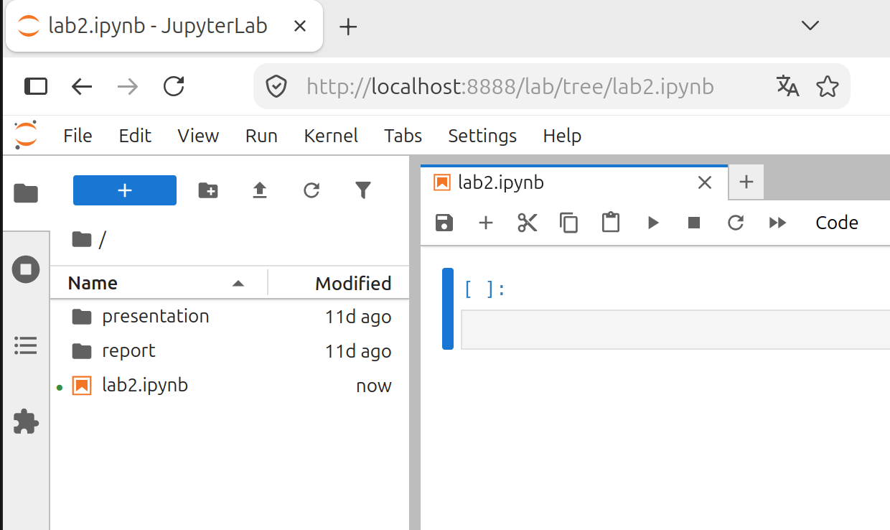{#fig-001 width=70%}

В ходе работы были изучены примеры создания кортежей, словарей, множеств и массивов, а также операции над ними.

## Выполнение заданий для самостоятельной работы

### Задание 1. Множества

Даны множества: A = {0, 3, 4, 9}, B = {1, 3, 4, 7}, C = {0, 1, 2, 4, 7, 8, 9}. Необходимо найти $P = A \cap B \cup A \cap C \cup B \cap C$.

Код для выполнения задания и результат его работы представлены на рис. -@fig-002.

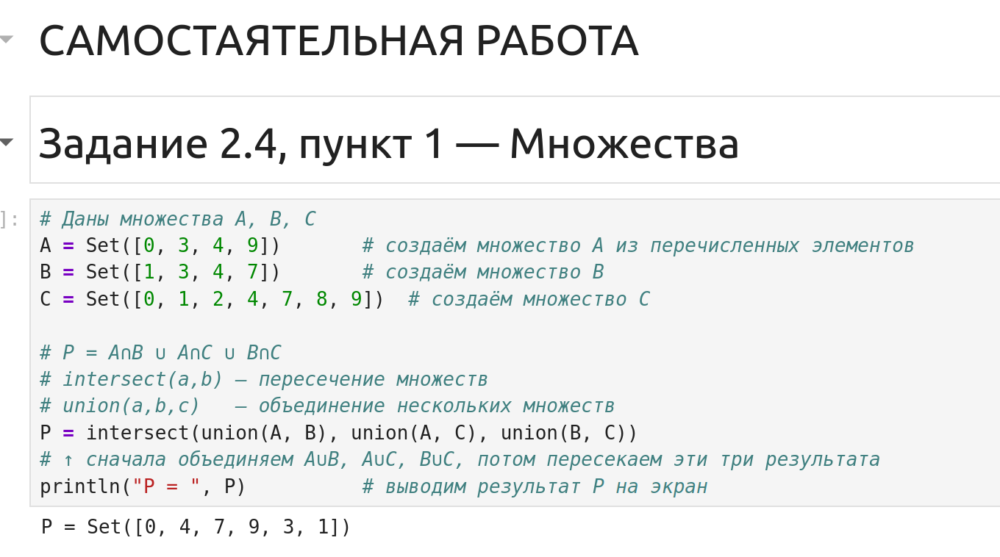{#fig-002 width=70%}

### Задание 2. Свои примеры с разными типами

Были созданы множества целых чисел, строк и смешанных типов. Выполнены операции объединения и пересечения (рис. -@fig-003).

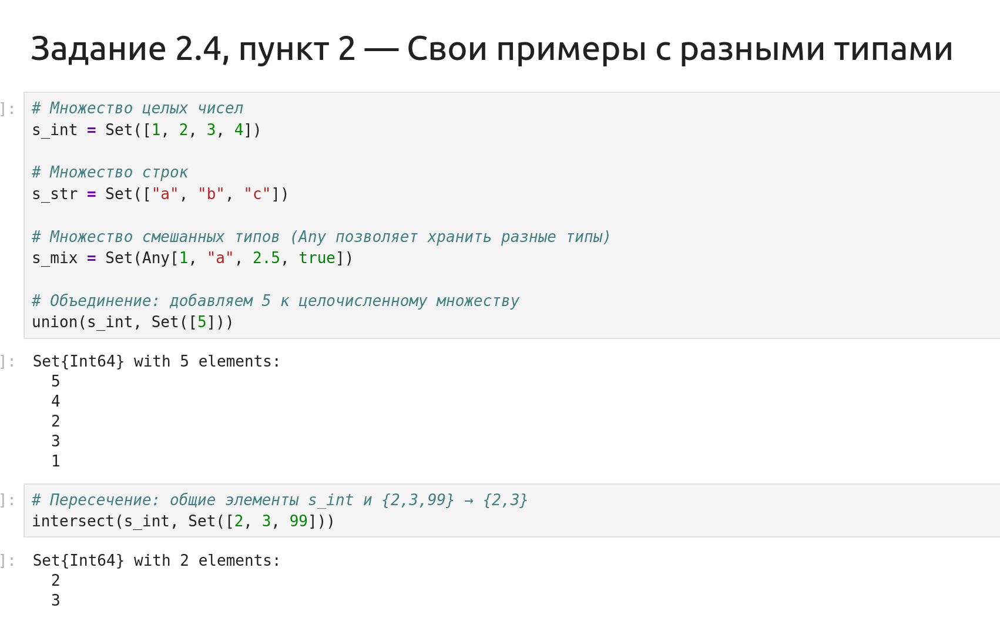{#fig-003 width=70%}

Также выполнена операция разности и проверка принадлежности элементов (рис. -@fig-004).

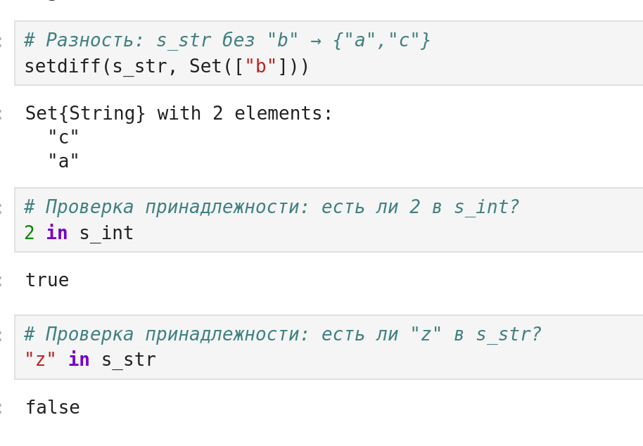{#fig-004 width=70%}

### Задание 3. Создание массивов разными способами

**Пункты 3.1–3.4.** Созданы кортежи с последовательностями чисел от 1 до N (N=25): возрастающие, убывающие, симметричные, а также произвольный кортеж (рис. -@fig-005).

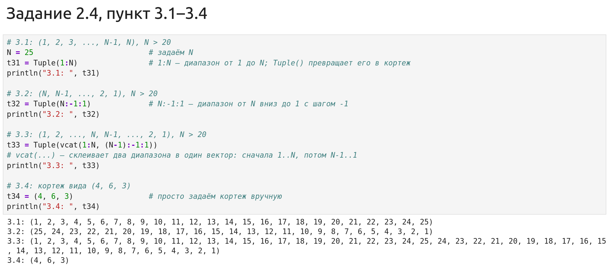{#fig-005 width=70%}

**Пункты 3.5–3.8.** Созданы кортежи с повторяющимися элементами с использованием функций `fill`, `repeat`, `vcat` (рис. -@fig-006).

{#fig-006 width=70%}

**Пункты 3.9–3.10.** Создан массив степеней двойки, подсчитано количество вхождений числа 6 (0 раз). Вычислена функция $y = e^x \cdot \cos(x)$ и найдено её среднее значение (рис. -@fig-007).

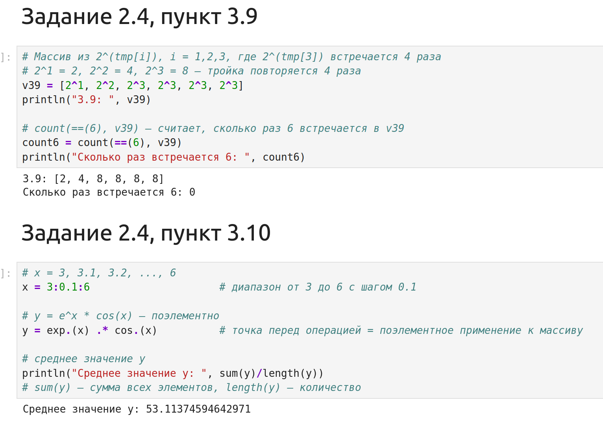{#fig-007 width=70%}

**Пункты 3.11–3.12.** Создан вектор кортежей $(x^i, y^j)$ и вектор с элементами $2^i / i$ (рис. -@fig-008).

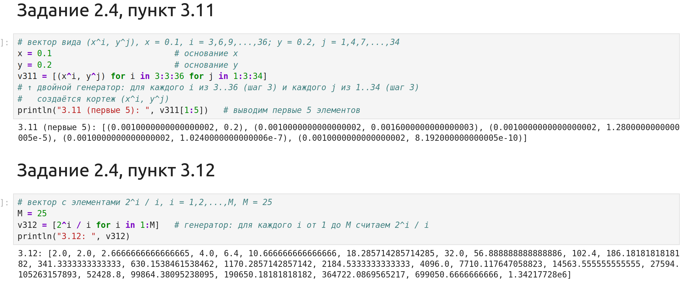{#fig-008 width=70%}

**Пункт 3.13.** Создан вектор строк вида `"fin1"`, `"fin2"`, ..., `"fin30"` (рис. -@fig-009).

{#fig-009 width=70%}

**Пункт 3.14. Большая задача.** Сгенерированы случайные векторы $x$ и $y$ длины 250. Вычислены векторы $v1, v2, v3$ и сумма (рис. -@fig-010).

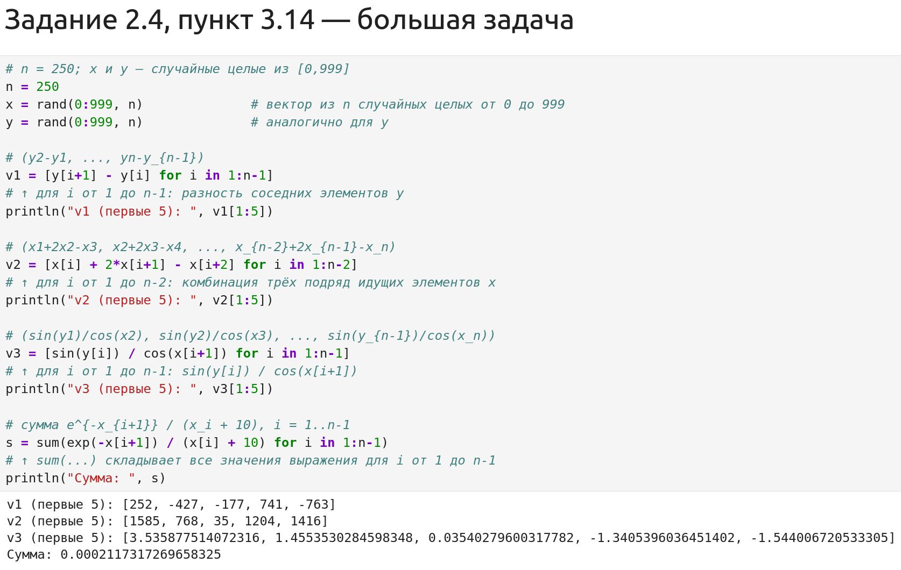{#fig-010 width=70%}

Выполнен поиск индексов элементов $y > 600$ и соответствующих им значений $x$ (рис. -@fig-011).

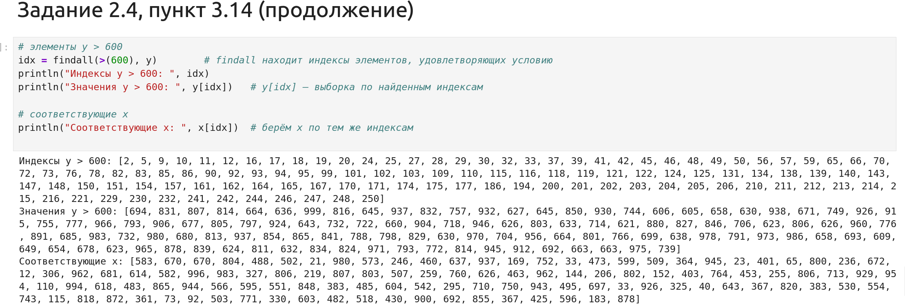{#fig-011 width=70%}

Вычислен вектор $v4$, подсчитано количество $y$, близких к максимуму, а также количество четных, нечетных и кратных 7 чисел в $x$ (рис. -@fig-012).

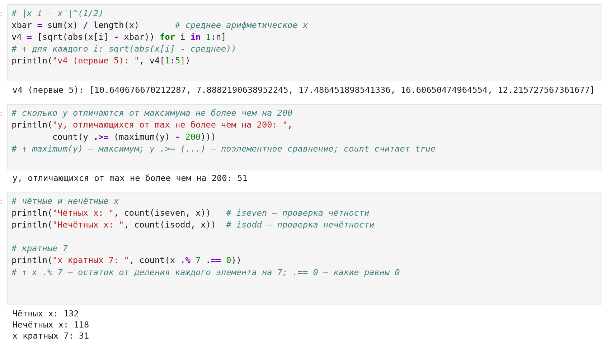{#fig-012 width=70%}

Выполнена сортировка $x$ по $y$, выборка топ-10 $y$ и вывод уникальных значений $x$ (рис. -@fig-013).

{#fig-013 width=70%}

### Задание 4. squares

Создан массив квадратов чисел от 1 до 100, выведены первые и последние 10 элементов (рис. -@fig-014).

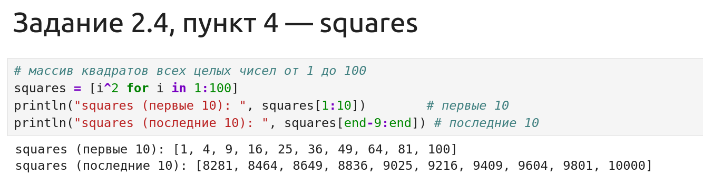{#fig-014 width=70%}

### Задание 5. Primes

Подключен пакет `Primes` [@primes_julia_pkg]. Сгенерирован массив из первых 168 простых чисел, найдено 89-е число, получен срез с 89 по 99 элемент (рис. -@fig-015).

{#fig-015 width=70%}

### Задание 6. Вычисление выражений

**Пункты 6.1–6.2.** Вычислены суммы: $\sum_{i=10}^{100} (i^3 + 4i^2)$ и $\sum_{i=1}^{25} ((2^i)/i + (3^i)/(i^2))$ (рис. -@fig-016).

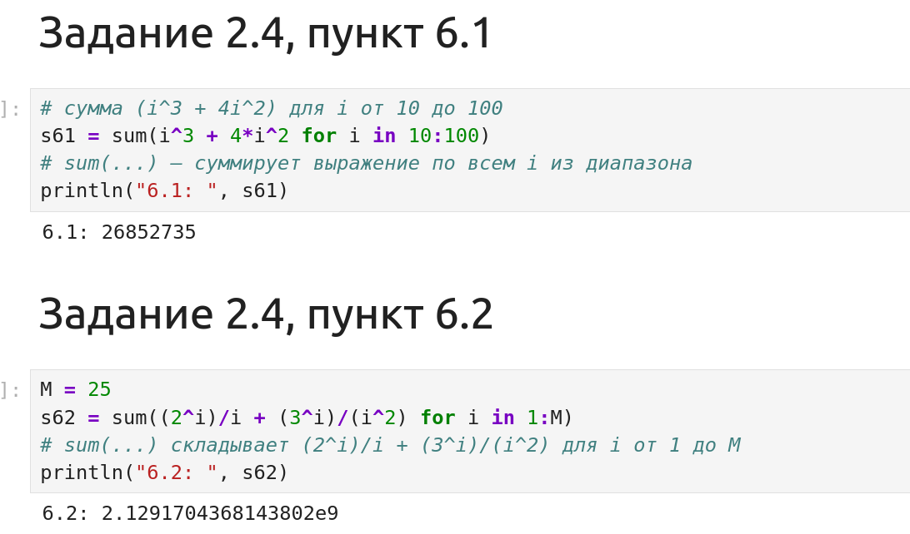{#fig-016 width=70%}

**Пункт 6.3.** Вычислена сумма ряда $1 + 2/3 + (2\cdot4)/(3\cdot5) + ...$ (рис. -@fig-017).

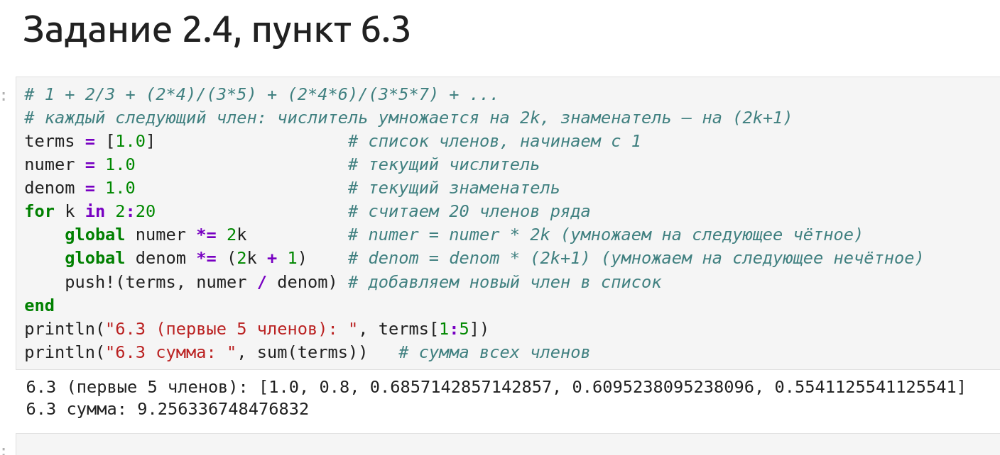{#fig-017 width=70%}

# Результаты

В ходе выполнения лабораторной работы были получены следующие результаты:

- Изучены синтаксис и операции для кортежей, словарей, множеств и массивов в Julia.
- Успешно выполнены все 14 пунктов заданий для самостоятельной работы.
- Получены числовые результаты для задач 3.9, 3.10, 3.14, 6.1, 6.2, 6.3.
- Сформированы векторы и массивы в соответствии с заданиями.

# Обсуждение результатов

Результаты выполнения заданий полностью соответствуют ожидаемым. Использование генераторов списков и встроенных функций Julia (таких как `union`, `intersect`, `setdiff`, `findall`, `sortperm`) позволило компактно и эффективно решить поставленные задачи [@bezanson_julia_2017]. Трудностей при выполнении не возникло, так как синтаксис языка интуитивно понятен, а документация доступна.

# Заключение

В ходе лабораторной работы были изучены основные структуры данных в Julia: кортежи, словари, множества и массивы. Были освоены методы их создания и операции над ними. Все задания для самостоятельной работы выполнены в полном объеме. Цель работы достигнута.

# Список литературы {.unnumbered}

::: {#refs}
:::
