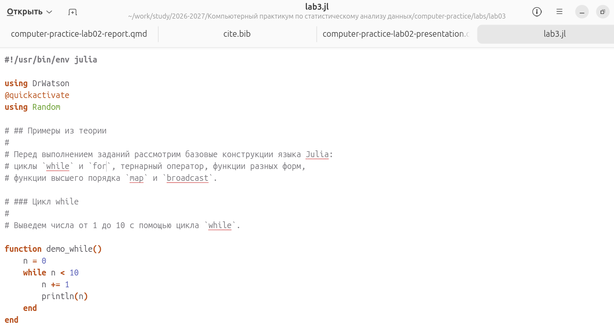
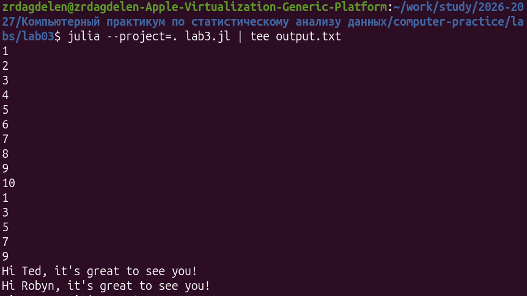
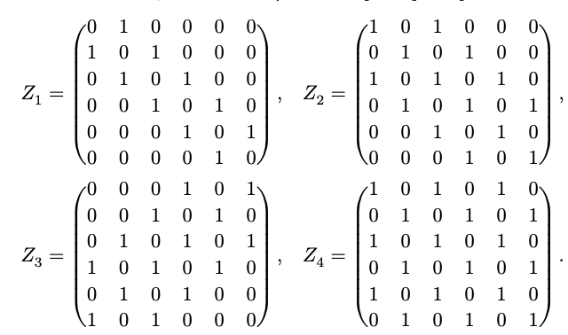
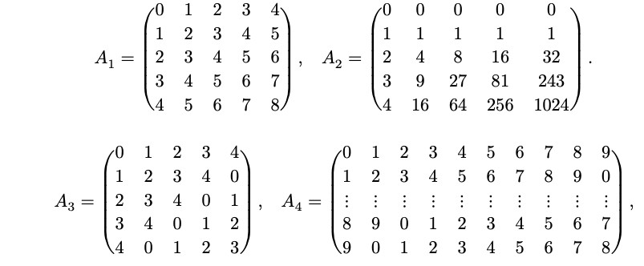
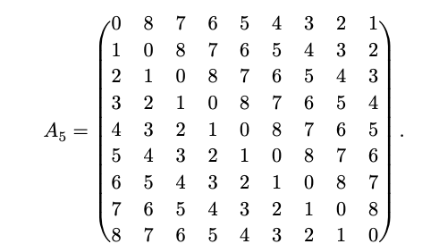

---
## Author
author:
  name: Дагделен Зейнап Реджеповна 
  email: 1132236052@rudn.ru
  affiliation:
    - name: Российский университет дружбы народов
      city: Москва
## Title
title: Лабораторная работа №3
subtitle: Управляющие структуры
license: CC BY
date: today
date-format: "YYYY-MM-DD" 
---

# Информация

## Докладчик

:::::::::::::: {.columns align=center}
::: {.column width="70%"}

  * КДагделен Зейнап Реджеповна
  * студентка НКНбд-01-23
  * Российский университет дружбы народов им. П. Лумумбы
  * [1132236052@rudn.ru](mailto:1132236052@rudn.ru)

:::
::: {.column width="30%"}


:::
::::::::::::::

# Вводная часть

## Актуальность

- Управляющие конструкции — базовый инструмент анализа данных
- Julia: циклы, функции высшего порядка, богатая экосистема пакетов
- Задачи линейной алгебры требуют эффективной работы с матрицами


## Цель и задачи

**Цель:** освоить циклы, функции и сторонние пакеты Julia для задач
линейной алгебры и работы с матрицами.

**Задачи:**

- Изучить циклы `while`/`for`, условные операторы, функции.
- Освоить `map` и `broadcast`.
- Реализовать функцию `outer()`.
- Применить пакеты `DrWatson` и `Literate`.

## Материалы и методы

- **Julia 1.12**, ОС Ubuntu
- Пакеты: `DrWatson`, `Literate`, `Random`
- Запуск: `julia --project=. lab3.jl | tee output.txt`
- Генерация отчёта: `julia --project=. tangle.jl lab3.jl`


# Ход работы


## Три ключевых этапа

{width=32%}
{width=32%}
{width=32%}

Редактор · Запуск · Генерация отчёта

# Теория

## Ключевые конструкции

- **Циклы:** `while`, `for`
- **Условия:** `if/else`, тернарный `?:`
- **Функции:** обычные, однострочные, анонимные, с `!`
- **Высшего порядка:** `map`, `broadcast` (`f.(xs)`)
- **`outer(x, y, op)`** → матрица `C[i,j] = op(x[i], y[j])`

# Результаты

## Задания 1–4: базовые конструкции

```julia
add_one(x) = x + 1
add_one.(A4x4)     # каждый элемент +1
```

- Квадраты 1..100, словарь `squares`, массив `squares_arr`
- Чёт/нечет: через `if` и тернарный оператор
- `broadcast` для поэлементной обработки матрицы

## Задания 5–7: матрицы

- **$A^3$ = 0** — матрица нильпотентна
- **C = BᵀB** = `[[1500, -1500], [-1500, 1500]]`
- **$Z_1..Z_4$** (6×6) — построены через циклы циклы `for`

{width=65%}


## Задание 8: функция `outer()`

```julia
function outer(x, y, operation)
    C = Matrix{Any}(undef, length(x), length(y))
    for i in 1:length(x), j in 1:length(y)
        C[i, j] = operation(x[i], y[j])
    end
    return C
end
```
Получены матрицы $A_1..A_5$ (5×5, 9×9, 10×10), которые были нужны по заданию:

{width=43%}
{width=37%}


## Задание 9: СЛАУ

```julia
A = build_A(5)       # A[i,j] = |i-j| + 1
x = A \ y            # x = [-2, 3, 5, 2, -4]ᵀ
```

- Проверка: `Ax ≈ y`, отклонение ~$10^(-15)$
- Обобщение на n = 10: отклонение 2·$10^(-16)$

## Задания 10–11

- **Матрица 6×10** (случайные целые 1..10):
  - строки с >4: `[8, 5, 6, 8, 8, 6]`
  - 7 ровно 2 раза: строки `[4, 6]`
  - 15 пар столбцов с суммой >75

- **Двойные суммы:**
  - $S_1$ = −639215.28
  - $S_2$ = −89912.02

# Заключение

## Итоги

- Все 11 заданий выполнены
- Освоены циклы, функции, `map`/`broadcast`, `outer()`
- Применены `DrWatson` и `Literate` — отчёт генерируется автоматически
- **Цель работы достигнута**

