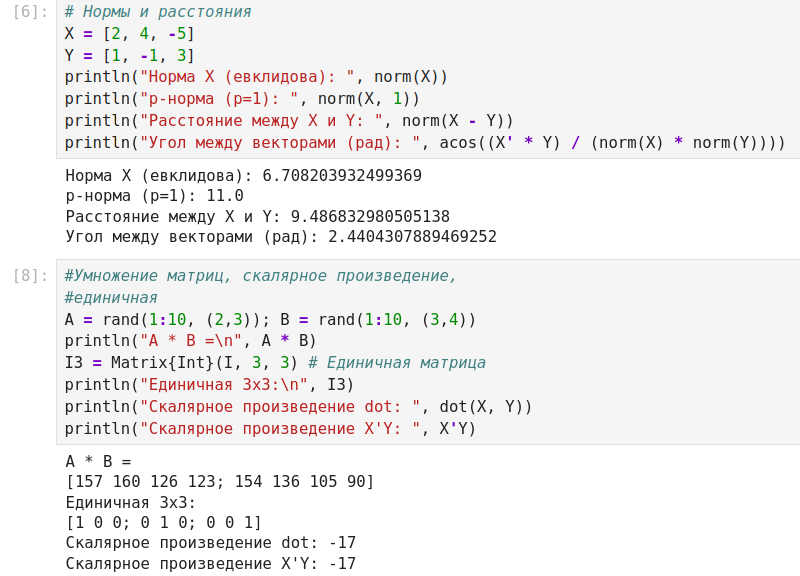
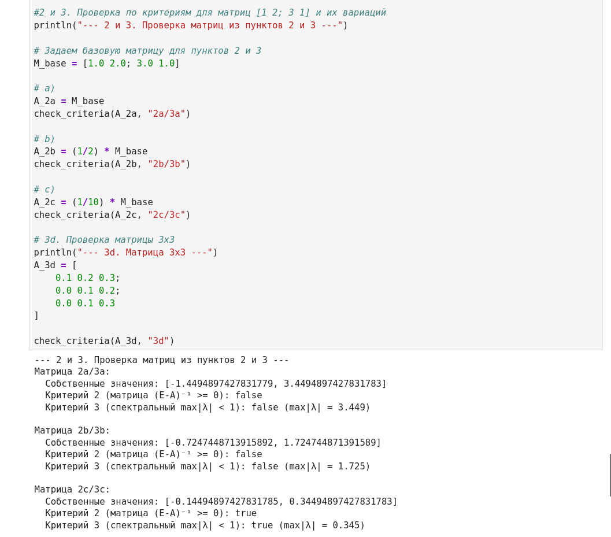

---
## Author
author:
  name: Дагделен Зейнап Реджеповна
  degrees: DSc
  orcid: 0000-0002-0877-7063
  email: 1132236052@rudn.ru
  affiliation:
    - name: Российский университет дружбы народов
      country: Российская Федерация
      postal-code: 117198
      city: Москва
## Title
title: Линейная алгебра в Julia
subtitle: Лабораторная работа №4
license: CC BY
date: today
date-format: "YYYY-MM-DD" # Example: 2025-09-06
---

# Информация

## Докладчик

:::::::::::::: {.columns align=center}
::: {.column width="70%"}

  * Дагделен Зейнап Реджеповна
  * студентка НКНбд-01-23
  * Российский университет дружбы народов им. П. Лумумбы
  * [1132236052@rudn.ru](mailto:1132236052@rudn.ru)

:::
::: {.column width="30%"}

:::
::::::::::::::

# Введение

## Актуальность

- Линейная алгебра — фундамент машинного обучения, физики, экономики.
- Эффективность матричных вычислений критически важна.
- Язык **Julia** сочетает скорость C и удобство Python.
- Специализированные пакеты позволяют избежать ручной реализации алгоритмов.

## Цели и задачи

- **Цель:** Изучить возможности пакетов Julia для линейной алгебры и оценить эффективность операций.
- **Задачи:**

    - Освоить базовые операции с матрицами и векторами.
    - Изучить факторизации (LU, QR) и спектральное разложение.
    - Провести бенчмаркинг вычислений.
    - Решить прикладные задачи (СЛАУ, модель Леонтьева).

# Теоретическая часть

## Поэлементные операции

- Работают независимо с каждым элементом массива.
- Функции `sum`, `prod`, `mean` в пакете `Statistics`.
- Векторизация операций (`.` — броадкастинг) ускоряет вычисления.
- Позволяет избегать циклов `for`.

{#fig-001 width=30%}

## Нормы и расстояния

- **Евклидова норма:** $\|\vec{X}\|_2 = \sqrt{\sum x_i^2}$
- **p-норма:** обобщение евклидовой нормы.
- **Расстояние** между векторами: $\|\vec{X} - \vec{Y}\|_2$.
- **Угол** между векторами через скалярное произведение.

{#fig-002 width=30%}

## Факторизации матриц

- **LU-разложение:** $A = LU$ (нижнетреугольная и верхнетреугольная).
- **QR-разложение:** $A = QR$ (ортогональная и верхнетреугольная).
- Применяются для решения СЛАУ и поиска собственных значений.
- В Julia реализованы в пакете `LinearAlgebra`.

{#fig-003 width=30%}

## Специальные структуры данных

- Julia поддерживает явное указание типа матрицы: `Symmetric`, `Diagonal`, `Tridiagonal`.
- Указание структуры позволяет алгоритмам **игнорировать проверки** и работать быстрее.
- «Зашумленная» матрица теряет свойства симметрии, что резко замедляет вычисления.

{#fig-004 width=30%}

# Прикладные задачи

## СЛАУ и псевдообратная матрица

- Для квадратных систем используется оператор `\`.
- Для переопределенных систем — `pinv` (псевдообратная матрица).
- Проверка совместности через ранги матриц (`rank`).

{#fig-005 width=30%}

## Диагонализация и спектр

- `eigen(A)` возвращает собственные значения и векторы.
- Диагональная матрица $\Lambda$ строится через `Diagonal`.
- Спектральное разложение: $A = V \Lambda V^{-1}$.

{#fig-006 width=30%}

## Степени и корни матриц

- Возведение в степень (`^`) и извлечение корней (`sqrt`) работают для матриц.
- Корни могут давать **комплексные числа**, если матрица не имеет вещественного спектра.
- Это связано с комплексными собственными значениями.

{#fig-007 width=30%}

## Модель Леонтьева

- Уравнение: $x - Ax = y$ (межотраслевой баланс).
- Матрица $A$ **продуктивна**, если решение $x \ge 0$ при любом $y \ge 0$.
- **Критерий 2:** все элементы $(E - A)^{-1} \ge 0$.
- **Критерий 3 (спектральный):** $\max|\lambda| < 1$.

{#fig-008 width=30%}

# Заключение

## Главный вывод

Использование специализированных структур данных и встроенных функций Julia позволяет не только упростить код, но и **значительно ускорить** вычисления. Явное указание типа матрицы (например, `Symmetric`) дает выигрыш в скорости в разы по сравнению с обычными массивами.
