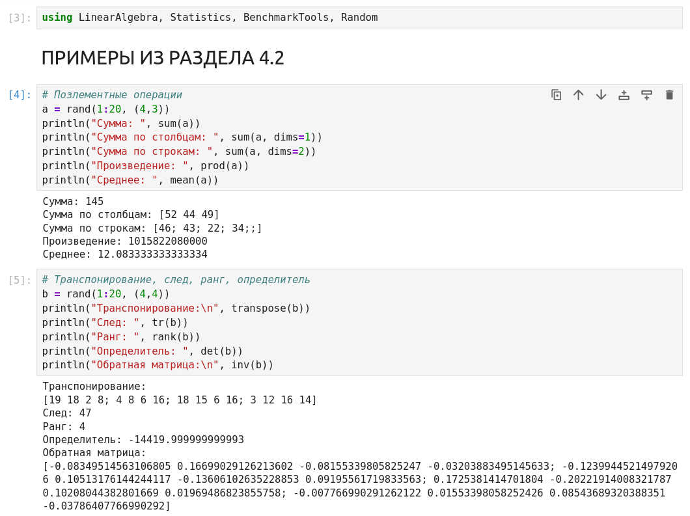
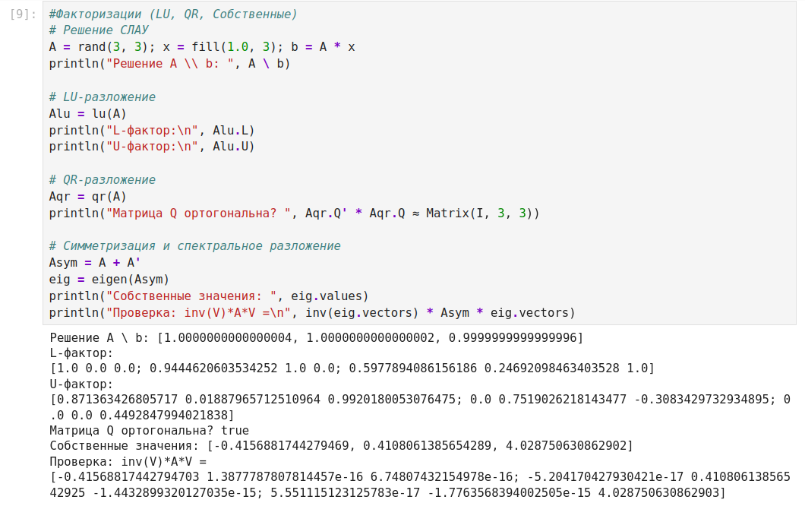
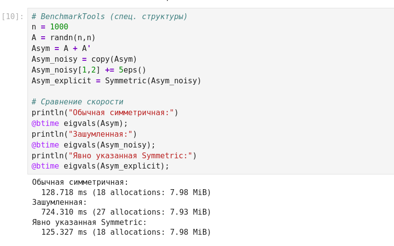
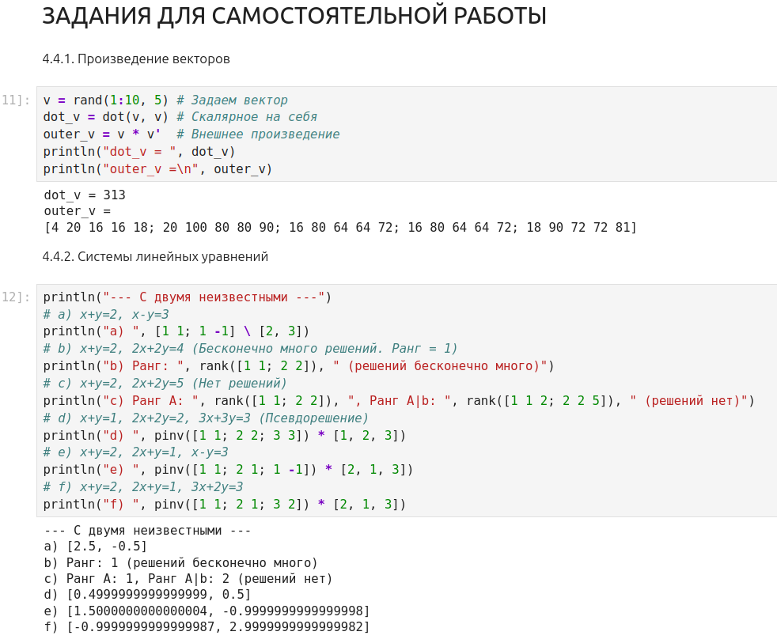
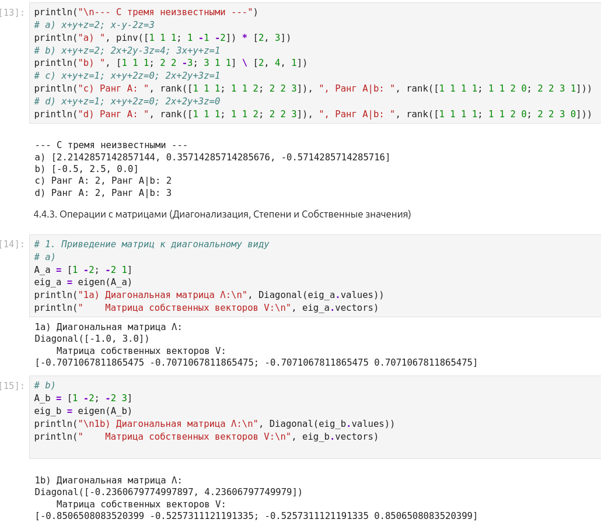
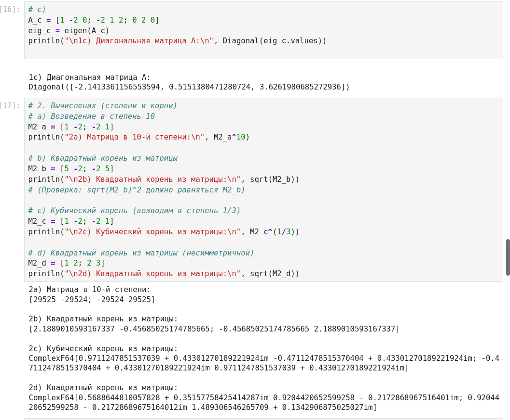
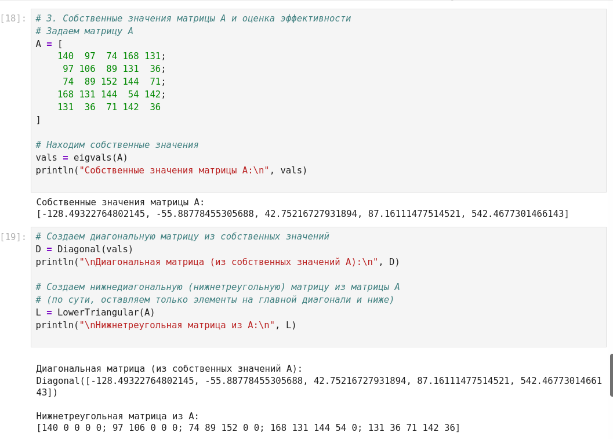
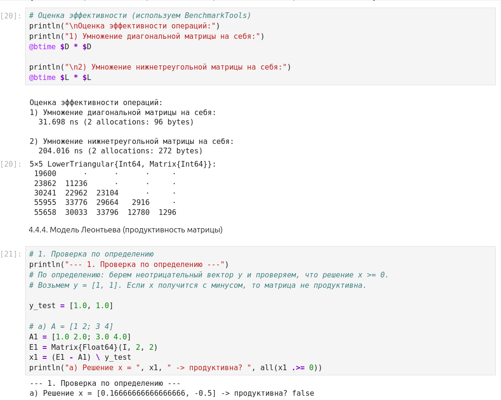
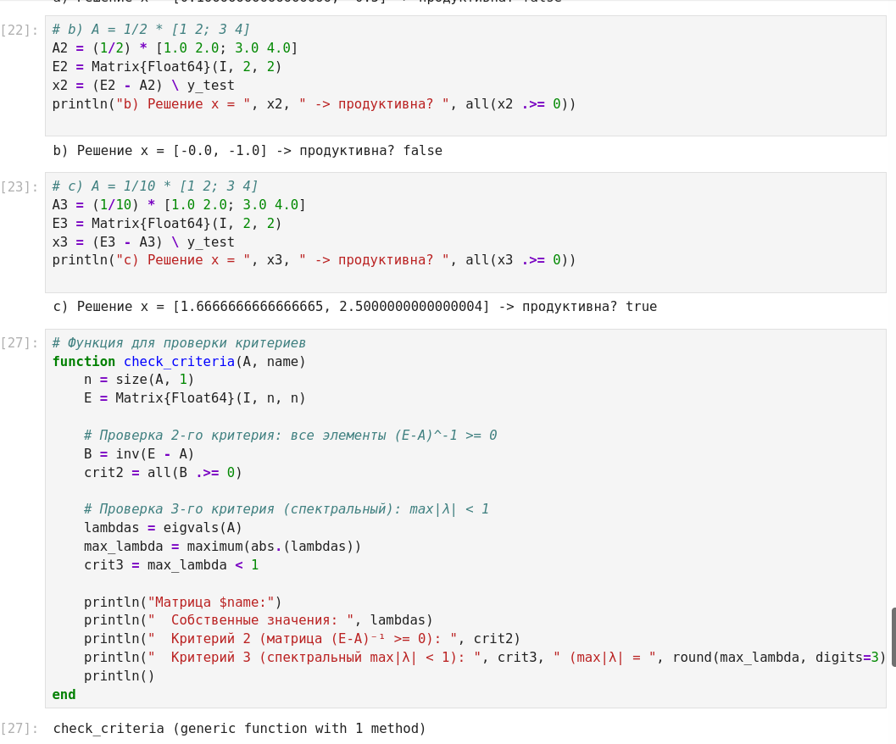
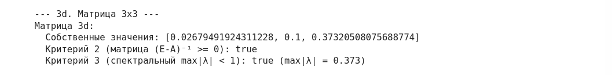

---
## Author
author:
  name: Дагделен Зейнап Реджеповна
  email: 1132236052.ru
  affiliation:
    - name: Российский университет дружбы народов
      country: Российская Федерация
      city: Москва

## Title
title: "Лабораторная работа № 4."
subtitle: "Линейная алгебра"
license: "CC BY"
abstract: |
  В данном отчёте представлены результаты выполнения лабораторной работы по теме «Линейная алгебра» с использованием языка программирования Julia. 

  Описаны использованные методы работы с матрицами и векторами, факторизации, спектрального разложения и модели Леонтьева. Полученные экспериментальные данные и их анализ подтверждают эффективность специализированных пакетов Julia.

  Сделаны выводы о достижении поставленной цели.
keywords: [линейная алгебра, Julia, матрицы, факторизация, модель Леонтьева]
---

# Введение

## Актуальность

Линейная алгебра является фундаментом для множества областей современной науки и техники: от машинного обучения и компьютерной графики до экономического моделирования и квантовой механики. Эффективная реализация операций над матрицами и векторами критически важна для производительности вычислительных систем. Язык Julia, обладающий высокой скоростью и удобным синтаксисом, предоставляет мощные инструменты для решения задач линейной алгебры.

## Цель работы

Основной целью работы является изучение возможностей специализированных пакетов Julia для выполнения и оценки эффективности операций над объектами линейной алгебры.

## Задачи

Для достижения поставленной цели необходимо решить следующие задачи:

1. Освоить базовые поэлементные операции над многомерными массивами.
2. Изучить операции транспонирования, нахождения следа, ранга, определителя и обратной матрицы.
3. Научиться вычислять нормы и расстояния между векторами, а также углы между ними.
4. Освоить матричное умножение и скалярное произведение.
5. Изучить факторизации (LU, QR) и спектральное разложение матриц.
6. Провести оценку эффективности вычислений с использованием пакета `BenchmarkTools`.
7. Выполнить задания для самостоятельной работы, включая решение СЛАУ, диагонализацию, вычисление корней и степеней матриц.
8. Реализовать проверку продуктивности матриц в модели Леонтьева по различным критериям.

## Объект и предмет исследования

**Объект исследования:** процессы выполнения операций линейной алгебры в языке программирования Julia.
**Предмет исследования:** эффективность и особенности реализации матричных и векторных вычислений с использованием стандартных библиотек и специализированных структур данных.

## Методы исследования

В работе использовались следующие методы:

- **Экспериментальный:** выполнение кода на языке Julia и анализ получаемых результатов.
- **Сравнительный:** оценка скорости выполнения операций с помощью пакета `BenchmarkTools` для различных типов матриц.
- **Аналитический:** проверка математических свойств (например, ортогональности матриц, продуктивности матриц по критериям).

# Теоретическая часть

В данной работе используются следующие основные понятия и операции линейной алгебры [@beklemishev_linear_algebra]:

1. **Поэлементные операции** над массивами: суммирование, умножение, нахождение среднего значения. Они применяются к каждому элементу независимо.
2. **Транспонирование** — операция, при которой строки матрицы становятся её столбцами (и наоборот).
3. **След матрицы** — сумма элементов главной диагонали.
4. **Ранг матрицы** — максимальное число линейно независимых строк (или столбцов).
5. **Определитель** — скалярная величина, характеризующая линейное преобразование.
6. **Обратная матрица** $A^{-1}$ — матрица, произведение которой на исходную $A$ даёт единичную матрицу $I$.
7. **Норма вектора** — длина вектора в евклидовом или другом пространстве.
8. **Скалярное произведение** — операция над двумя векторами, результатом которой является число.
9. **Факторизация** — разложение матрицы на произведение матриц специального вида (LU, QR).
10. **Спектральное разложение** — представление матрицы в виде $A = V \Lambda V^{-1}$, где $\Lambda$ — диагональная матрица собственных значений, $V$ — матрица собственных векторов.
11. **Модель Леонтьева** — модель межотраслевого баланса, где матрица $A$ называется продуктивной, если уравнение $x - Ax = y$ имеет неотрицательное решение $x$ при любом неотрицательном $y$. Критерии продуктивности: матрица $(E - A)^{-1}$ неотрицательна, либо все собственные значения $A$ по модулю меньше 1.

Все программные примеры выполнялись на языке Julia с использованием стандартных библиотек. Синтаксис языка, работа с массивами и специализированными матричными структурами (например, `Symmetric`, `Diagonal`) подробно описаны в официальной документации [@julia_docs].

# Материалы и методы

**Программное обеспечение:** язык программирования Julia (версия 1.x) и следующие пакеты:

- `LinearAlgebra` — для выполнения основных операций линейной алгебры.
- `Statistics` — для вычисления средних значений.
- `Random` — для генерации случайных чисел и матриц.
- `BenchmarkTools` — для оценки времени выполнения операций (`@btime`).

**Оборудование:** персональный компьютер с установленной средой разработки (например, Jupyter Notebook или REPL Julia).

**Последовательность действий:**

1. Подключение необходимых пакетов.
2. Выполнение примеров из раздела 4.2 методических указаний с фиксацией результатов в скриншотах.
3. Выполнение заданий для самостоятельной работы (пункты 4.4.1 – 4.4.4).
4. Оценка эффективности операций с помощью бенчмаркинга.
5. Оформление отчёта с описанием каждого шага и приложением скриншотов.

# Выполнение лабораторной работы

В ходе работы были выполнены следующие действия, соответствующие разделам методических указаний.

## Примеры из раздела 4.2

### Поэлементные операции и операции над матрицами

На рис. -@fig-001 представлен код и результаты выполнения базовых поэлементных операций над матрицей 4x3 (сумма, произведение, среднее), а также операции транспонирования, нахождения следа, ранга, определителя и обратной матрицы для матрицы 4x4.

{#fig-001 width=100%}

### Нормы, расстояния и умножение матриц

На рис. -@fig-002 показано вычисление норм векторов (евклидовой и p-нормы), расстояния между векторами и угла между ними. Также продемонстрировано умножение матриц, создание единичной матрицы и вычисление скалярного произведения векторов двумя способами.

{#fig-002 width=100%}

### Факторизации и спектральное разложение

На рис. -@fig-003 приведен пример решения СЛАУ, выполнения LU- и QR-разложения, а также проверки ортогональности матрицы Q и спектрального разложения симметризованной матрицы.

{#fig-003 width=100%}

### Оценка эффективности с использованием BenchmarkTools

На рис. -@fig-004 продемонстрировано сравнение скорости вычисления собственных значений для обычной симметричной матрицы, зашумленной матрицы и матрицы с явно указанной структурой `Symmetric`. Показано, что явное указание структуры позволяет значительно ускорить вычисления.

{#fig-004 width=100%}

## Задания для самостоятельной работы

### Произведение векторов (4.4.1)

На рис. -@fig-005 представлено вычисление скалярного произведения вектора на самого себя и внешнего произведения (матрицы).

{#fig-005 width=100%}

### Системы линейных уравнений (4.4.2)

На рис. -@fig-006 показано решение СЛАУ с двумя неизвестными. Рассмотрены случаи единственного решения, бесконечного множества решений (ранг матрицы равен 1), отсутствия решений и переопределенных систем (решение через псевдообратную матрицу).

{#fig-006 width=100%}

На рис. -@fig-007 показано решение СЛАУ с тремя неизвестными. Аналогично проверена совместность систем с помощью рангов основной и расширенной матриц, а также найдены решения через `pinv`.

{#fig-007 width=100%}

### Операции с матрицами (4.4.3)

На рис. -@fig-008 и -@fig-009 представлено приведение матриц 2x2 и 3x3 к диагональному виду (нахождение собственных значений и собственных векторов).

{#fig-008 width=100%}

{#fig-009 width=100%}

На рис. -@fig-010 показаны вычисления степеней и корней матриц. Возведение в 10-ю степень дало целочисленную матрицу, а извлечение квадратного и кубического корней — комплексные числа.

{#fig-010 width=100%}

На рис. -@fig-011 представлено нахождение собственных значений для заданной матрицы 5x5, создание диагональной матрицы из этих значений и выделение нижнетреугольной части исходной матрицы.

{#fig-011 width=100%}

На рис. -@fig-012 приведена оценка эффективности умножения диагональной и нижнетреугольной матриц. Умножение диагональной матрицы происходит значительно быстрее.

{#fig-012 width=100%}

### Модель Леонтьева (4.4.4)

На рис. -@fig-013 и -@fig-014 показана проверка продуктивности матриц по определению (через решение уравнения $x - Ax = y$) и по критериям (неотрицательность обратной матрицы $(E - A)^{-1}$ и спектральный критерий $\max|\lambda| < 1$). 

{#fig-013 width=100%}

{#fig-014 width=100%}

# Результаты

В ходе выполнения работы были получены следующие основные результаты:

1. **Базовые операции:** Успешно выполнены все базовые операции над матрицами и векторами, результаты совпадают с математическими ожиданиями.
2. **Факторизации:** Получены LU- и QR-разложения. Проверка ортогональности матрицы Q дала значение `true`. Спектральное разложение подтверждено проверкой `inv(V)*A*V`, результат которой близок к диагональной матрице.
3. **Бенчмаркинг:** Вычисление собственных значений для явно симметричной матрицы заняло ~125 мс, для обычной симметричной — ~128 мс, а для «зашумленной» матрицы — ~724 мс. Явное указание структуры `Symmetric` позволяет избежать проверок и работает так же быстро, как и с обычной симметричной матрицей.
4. **СЛАУ:** Решены системы с двумя и тремя неизвестными. Для несовместных систем ранг основной матрицы оказался меньше ранга расширенной. Для систем с бесконечным числом решений ранги совпадали.
5. **Собственные значения и диагонализация:** Найдены собственные значения для матриц 2x2, 3x3 и 5x5. Построены диагональные матрицы $\Lambda$ и матрицы собственных векторов $V$.
6. **Степени и корни:** Возведение в 10-ю степень дало матрицу с целыми числами. Корни (квадратные и кубические) из матриц были вычислены в комплексной области.
7. **Модель Леонтьева:** Матрицы $A = \begin{bmatrix} 1 & 2 \\ 3 & 4 \end{bmatrix}$ и $\frac{1}{2} \begin{bmatrix} 1 & 2 \\ 3 & 4 \end{bmatrix}$ оказались непродуктивными (решение содержит отрицательные компоненты, критерии дают `false`). Матрица $\frac{1}{10} \begin{bmatrix} 1 & 2 \\ 3 & 4 \end{bmatrix}$ и заданная матрица 3x3 являются продуктивными (все критерии `true`).

# Обсуждение результатов

Полученные результаты полностью согласуются с теоретическими сведениями. 

- **Эффективность:** Результаты бенчмаркинга наглядно демонстрируют важность использования специализированных структур данных (например, `Symmetric`) для оптимизации вычислений. Если матрица математически симметрична, но в неё добавлен шум, компьютер трактует её как обычную, что замедляет работу в разы. Явное указание типа позволяет алгоритмам использовать свойства симметрии.
- **СЛАУ:** Использование псевдообратной матрицы `pinv` позволило найти решения для переопределенных систем, что демонстрирует гибкость Julia.
- **Корни матриц:** Появление комплексных чисел при извлечении корней из матриц объясняется тем, что не все матрицы имеют вещественные корни (спектр матрицы может содержать комплексные значения).
- **Модель Леонтьева:** Проверка продуктивности показала, что даже небольшие изменения в матрице (умножение на коэффициент) могут кардинально менять её свойства. Спектральный критерий и критерий неотрицательности обратной матрицы дали согласованные результаты.

# Заключение

В ходе выполнения лабораторной работы были изучены возможности языка Julia и его пакетов для решения задач линейной алгебры.

**Основные итоги:**

1. Освоены базовые операции над матрицами и векторами, включая факторизации и спектральное разложение.
2. Проведена оценка эффективности вычислений с помощью `BenchmarkTools`, подтверждена важность использования специализированных структур данных.
3. Решены практические задачи: СЛАУ, диагонализация матриц, вычисление степеней и корней, проверка продуктивности матриц в модели Леонтьева.
4. Полученные результаты демонстрируют высокую скорость и удобство работы с линейной алгеброй в Julia.

Цель работы достигнута в полном объёме.

# Список литературы {.unnumbered}

::: {#refs}
:::
