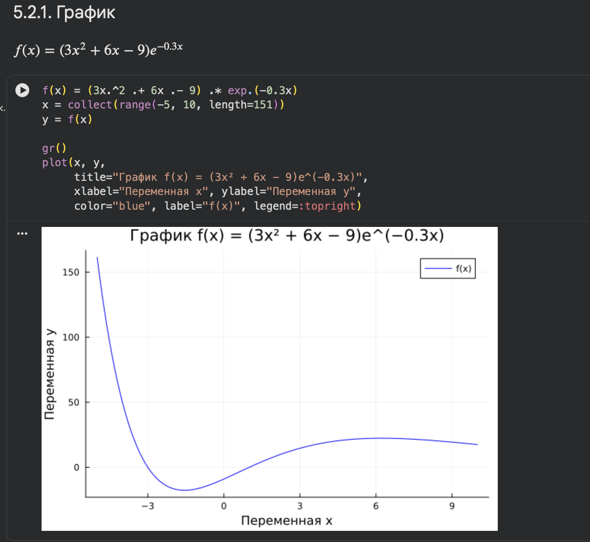
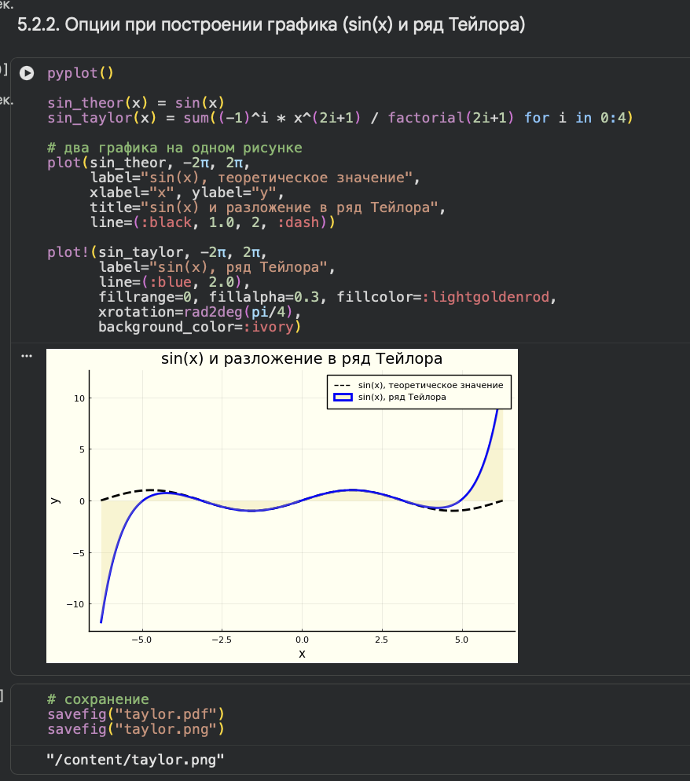
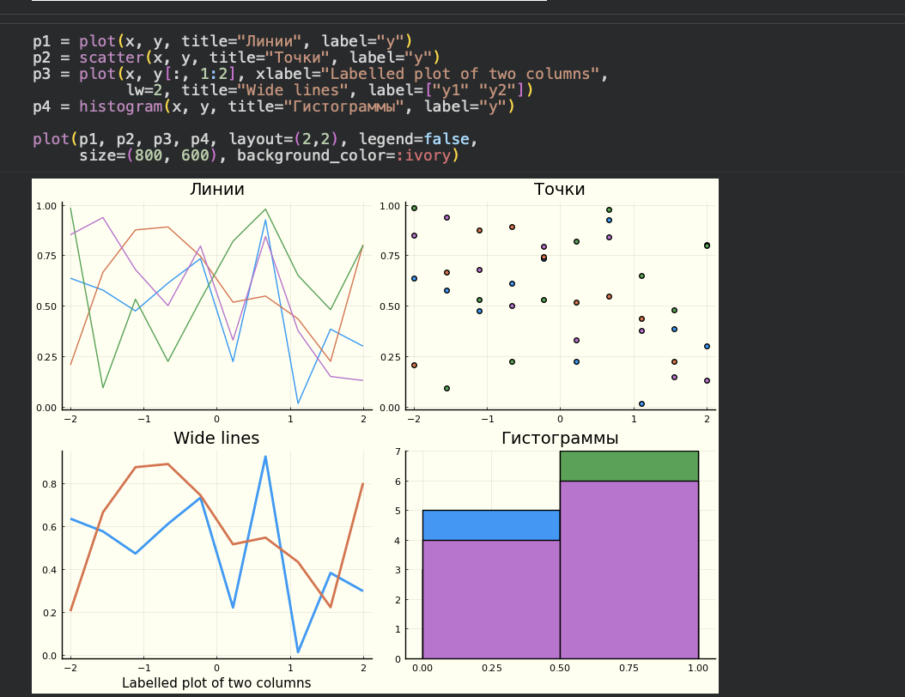
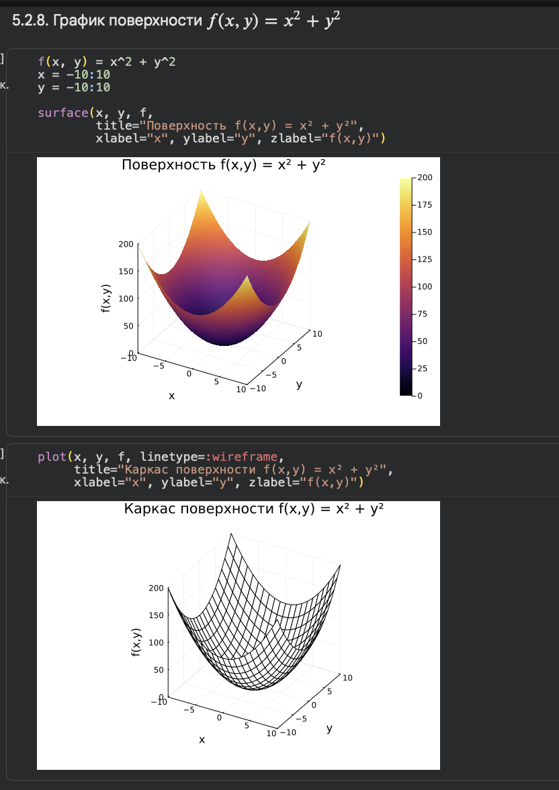
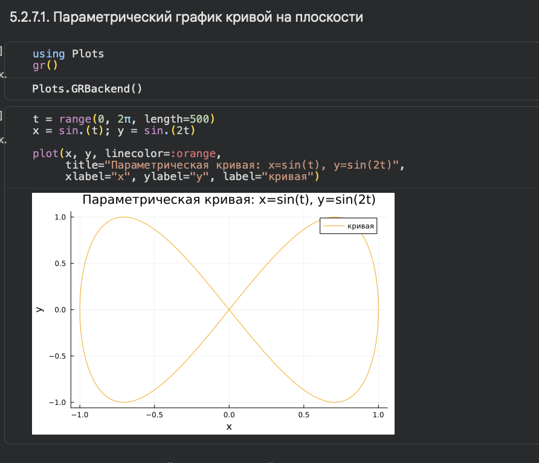
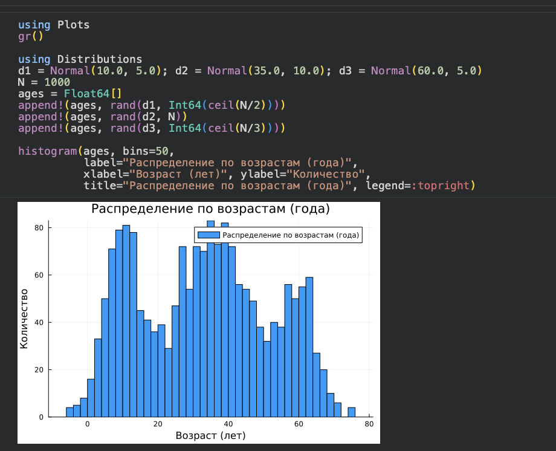
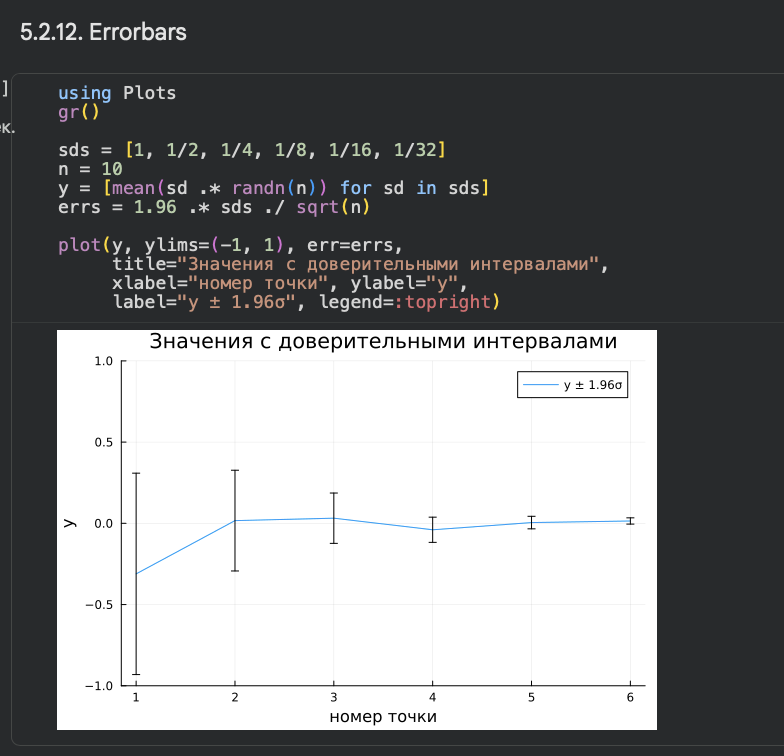

---
## Author
author:
  name: Дагделен Зейнап Реджеповна
  email: 1132234052@rudn.ru
  affiliation:
    - name: Российский университет дружбы народов
      country: Российская Федерация
      city: Москва
      address: ул. Орджоникиздзе, д. 3
## Title
title: "Лабораторная работа № 5"
subtitle: "Построение графиков в Julia"
license: CC BY
date: today
date-format: "YYYY-MM-DD"
---

# Информация

## Докладчик

:::::::::::::: {.columns align=center}
::: {.column width="70%"}

  * Дагделен Зейнап Реджеповна
  * студентка НКНбд-01-23
  * Российский университет дружбы народов им. П. Лумумбы
  * [1132234052@rudn.ru](mailto:1132234052@rudn.ru)

:::
::: {.column width="40%"}

:::
::::::::::::::

# Введение

## Цель и задачи

- **Цель:** Освоить синтаксис языка Julia для построения графиков с помощью пакета `Plots.jl`.
- **Инструменты:**
  - Пакет `Plots.jl` (основной инструмент).
  - Бэкенды: `gr()`, `pyplot()`, `plotly()`, `unicodeplots()`.
  - Пакеты для статистики: `Statistics`, `Distributions`.

::: notes
- Основная идея: один синтаксис `plot(...)` позволяет менять "движок" отрисовки (бэкенд) одной командой.
:::

# Теоретическая часть

## Базовые функции: `plot()` и `scatter()`

1) **plot(x, y)** — построение линейного графика (соединяет точки линиями). 2) **scatter(x, y)** — построение точечного графика (только маркеры, без линий). 3)**Поэлементные операции:** В Julia для применения функции к массиву используется точка (`.`): `x.^2`, `exp.(x)`, `sin.(x)`.

{width=40%}

::: notes
- `plot` используется для непрерывных функций. `scatter` — для дискретных данных или статистики.
- Бэкенд `gr()` выбран по умолчанию, он быстрый.
:::

## Настройка осей и легенды

- **`xlabel`, `ylabel`** — подписи осей, **`title`** — заголовок графика, **`label`** — текст в легенде., **`legend`** — позиция легенды (например, `:topright`), **`color`** — цвет линии или маркера.

{width=40%}

::: notes
- Легенда появляется автоматически, если задан `label`.
- Параметр `line=(:black, 1.0, 2, :dash)` задает цвет, толщину и тип линии (пунктир).
:::

## Комбинирование графиков

- **plot!(...)** — добавить график на уже существующий (восклицательный знак означает изменение *in-place*). **layout** — создание сетки подграфиков.

{width=40%}

::: notes
- В одной ячейке мы можем сначала вызвать `plot` для первого графика, а потом `plot!` для второго, чтобы они наложились.
- `layout` незаменим, когда нужно сравнить разные представления одних и тех же данных.
:::

## 3D-графики и поверхности

- **scatter(x, y, z)** — 3D точечный график. **surface(x, y, f)** — поверхность. **linetype=:wireframe** — каркасный вид поверхности.

{width=30%}

::: notes
- Для 3D графиков Julia использует интерактивные бэкенды (например, `plotly`) или статические (`pyplot`, `gr`).
- `surface` автоматически подбирает цветовую шкалу для оси Z.
:::

## Параметрические кривые

- Позволяют задать координаты как функции от параметра $t$. В коде мы создаем массив $t$ (например, range(0, 2π, length=500)).
- Вычисляем $x = \sin.(t)$ и $y = \sin.(2t)$. Результат — фигура Лиссажу на плоскости.

{width=40%}

::: notes
- Параметрический подход полезен, когда $y$ не является однозначной функцией от $x$ (как в случае замкнутых кривых).
:::

## Статистика и распределения

- **histogram(data)** — гистограмма (автоматически разбивает данные на интервалы). Пакет `Distributions` позволяет генерировать выборки: rand(Normal(μ, σ), N). Пакет `Statistics` используется для расчета средних и отклонений.

{width=40%}

::: notes
- Гистограмма — основной инструмент визуализации плотности распределения.
- В лабораторной мы строили смесь трех нормальных распределений, задавая разные мат. ожидания.
:::

## Погрешности (Errorbars)

- Параметр **err** в функции `plot()` добавляет вертикальные "усы" погрешностей. Используется для визуализации доверительных интервалов. В коде мы вычисляли погрешность как $1.96 \cdot \text{std} / \sqrt{n}$.

{width=40%}

::: notes
- 1.96 — это квантиль нормального распределения для 95% доверительного интервала.
- Визуализация погрешностей обязательна в серьезных научных работах.
:::

# Выводы

## Заключение

- Освоен базовый синтаксис `Plots.jl` для 2D и 3D графиков.
- Изучено построение графиков с несколькими осями и наложение слоев.
- Выполнены задания на оформление, кастомизацию и статистическую визуализацию.
- `Plots.jl` позволяет быстро переключаться между разными движками отрисовки (`gr`, `pyplot`, `plotly`) без изменения основного кода.

::: notes
- Главный итог: код на Julia получается коротким, читаемым и легко переносится между форматами вывода (PDF, HTML, PNG).
:::
